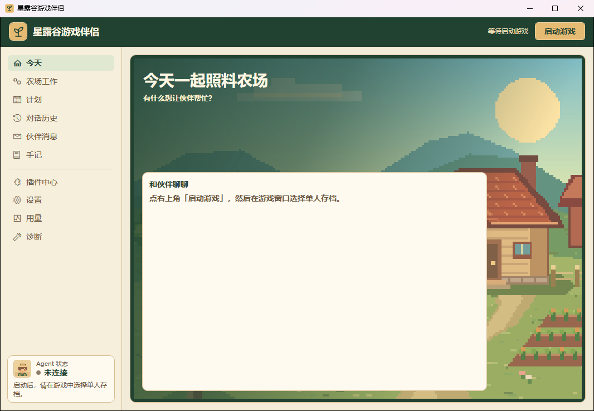

# 星露谷游戏伴侣

用自然语言安排农场生活，和 AI 伙伴一起玩《星露谷物语》。

[下载绿色包](https://github.com/nekoimi/stardew-game-companion/releases) · [在线文档](https://nekoimi.github.io/stardew-game-companion/) · [使用指南](https://nekoimi.github.io/stardew-game-companion/guide/getting-started) · [更新日志](https://nekoimi.github.io/stardew-game-companion/reference/changelog) · [报告问题](https://github.com/nekoimi/stardew-game-companion/issues) · [参与贡献](https://nekoimi.github.io/stardew-game-companion/reference/contributing)

星露谷游戏伴侣是一款开源的 Windows 桌面程序。你可以请伙伴帮忙照料农场，也可以把单人角色交给 AI，观察它推进目标，再随时接管或调整安排。解压即可启动，填写模型 API Key 即可使用，Node 与 Agent 运行时随包提供。

> 项目处于 **0.x 开发阶段**，目前主要支持单人农场协作。建议先备份存档；开发版请在 Releases 的预发布条目中下载。

## 预览

*当前 GUI 的实际启动界面，尚未连接游戏。进入存档后可在「今天」交流、发送指令并查看执行状态。*

## 可以做什么

| 能力 | 说明 |
| --- | --- |
| 自然语言交互 | 聊天、交代任务、补充约定，或在执行过程中调整目标。 |
| 两种游玩方式 | 让拥有独立背包、工具和体力的伙伴帮忙，或让 AI 操作单人角色。 |
| 持续推进目标 | 根据游戏观察和动作回执安排后续工作。支持连续直走和斜走、暂停、改派和玩家接管。 |
| 按存档保留伙伴 | 管理角色、对话、记忆、目标和模型用量，切换模型后沿用伙伴资料。 |
| 桌面统一管理 | 启动游戏、配置模型，查看思考、寻路和执行状态；农场工作汇总阶段成果，最近进展可刷新观察或核对旧动作。支持最小化到托盘。 |
| 插件扩展 | 安装本地插件、接入在线目录，管理启停、自动启动、更新与版本回退。 |

你可以这样交代：

> 把农舍前的作物浇完。
>
> 今天先照料作物，再采些木头，保留幼树。
>
> 接下来农场交给你，优先发展种植，记得按时回家休息。

目前已覆盖种植、收获、动物照料、加工、仓储和部分布局施工。具体范围与限制见[农场工作说明](https://nekoimi.github.io/stardew-game-companion/reference/farm-projects)，社区中心献祭仍需玩家提交。

## 快速开始

### 准备

- Windows x64。
- 已安装的《星露谷物语》和 [SMAPI](https://smapi.io/)。
- 可用的模型 API Key；模型调用费用由所选服务商收取。

### 启动

1. 从 [Releases](https://github.com/nekoimi/stardew-game-companion/releases) 下载 `StardewGameCompanion-<版本>-windows-x64.zip`，完整解压到可写目录。
2. 双击根目录的 **星露谷游戏伴侣.exe**。桌面运行库、Node 与 Agent 已随包提供，无需另装模型客户端。
3. 在「设置」选择游戏目录和游玩方式，再到「模型连接」选择服务商、填写 API Key，点击「测试连接」并保存。
4. 点击「启动游戏」，进入单人存档后，在桌面「今天」发送指令。使用「AI 自己玩」时，点击「交给 AI」开始托管。

关闭窗口时可选择最小化到托盘，双击通知区域的伴侣图标可恢复窗口。常见操作、配置位置和日志入口见[使用指南](https://nekoimi.github.io/stardew-game-companion/guide/getting-started)。

桌面状态连接短暂中断时会自动重连，并保留进展和未发送内容；游戏可能仍在执行，需要停止时可在游戏中按 F9 接管。

模型临时限流或断线时，桌面会显示「等待重试」，恢复后接着推进当前工作。重试耗尽或需要处理模型配置时，桌面会显示失败原因。

## 游玩方式

| 模式 | 操作方式 |
| --- | --- |
| 伙伴模式 | 你操作玩家，AI 操作独立伙伴。伙伴使用自己的背包、工具和体力，头顶显示存档中设置的名字。 |
| AI 自己玩（首次启动默认） | AI 操作单人角色。你可以暂停或改派，在游戏窗口按 **F9** 立即接管。 |

「今天」显示对话、指令进度和控制权，左下角常驻 Agent 状态。「农场工作」与「计划」查看安排，「对话历史」「伙伴消息」和「手记」查看交流与约定。

两种模式都遵循「设置 → 存档偏好」中的就寝时间，提前为回家留出路程。AI 操作主角时会回床保存过夜，次日根据新观察继续目标；伙伴模式由玩家决定何时结束当天。修改游玩方式需要重启游戏。

## 模型接入与数据

| 接入方式 | 配置 |
| --- | --- |
| DeepSeek 官方 | API Key 与模型。 |
| OpenAI 官方 | API Key 与模型。 |
| 自定义接口 | OpenAI Chat Completions 或 Responses 协议，自定义 HTTPS Base URL、模型 ID 与 API Key。 |

支持流式与非流式响应，可按服务能力配置。「测试连接」会验证工具调用和回执。[模型配置说明](https://nekoimi.github.io/stardew-game-companion/guide/models)

模型请求附带精简的游戏概况，背包、箱子等详情按需查询。「用量」可查看当前存档最近任务的请求次数、重试和已报告的 Token。

游戏存档由游戏保存。伙伴资料、聊天和用量按存档保存在绿色包的 `data/companion.sqlite`，API Key 交由 Windows 凭据管理器保存。运行时会向你选择的模型服务发送指令、相关游戏状态和工具结果。

在「设置 → 关于与更新」可检查版本、切换镜像目录，或选择本地 ZIP，并查看下载和校验进度。确认安装后，独立窗口会显示备份、安装和自检的当前步骤。更新在原目录安装并保留数据，换目录时可导入旧绿色包或连接已有数据目录。[更新与回退](https://nekoimi.github.io/stardew-game-companion/reference/desktop-guide#更新与回退)

运行日志保存在本地文件，可从「诊断」打开日志目录。报告问题或分享日志前，请移除密钥、私人路径和存档信息。

## 插件扩展

「插件中心」支持安装本地 ZIP，以及通过 HTTPS 在线目录发现、安装和更新插件。插件可以有自己的设置页，支持自动启动和版本回退。

插件通过通用接口订阅公开游戏状态、接收伙伴回复、提交指令并查询结果。业务规则由插件实现，桌面程序负责进程管理和通信。玩家仍可暂停、改派或接管。

[玩家使用说明](https://nekoimi.github.io/stardew-game-companion/guide/plugins) · [插件协议](https://nekoimi.github.io/stardew-game-companion/reference/plugin-protocol) · [参考插件](https://nekoimi.github.io/stardew-game-companion/reference/plugin-examples)

## 开发与贡献

项目由桌面程序、Agent 运行时和游戏 Mod 组成，通过接口协作：

| 组件 | 技术 | 职责 |
| --- | --- | --- |
| `apps/desktop` | C# / WPF | 桌面界面、启动与配置、Windows 凭据、插件宿主。 |
| `apps/runtime` | TypeScript / Node.js | 模型接入、伙伴数据、回合执行与任务调度。 |
| `apps/game-mod` | C# / SMAPI | 游戏观察、原生动作执行和结果回执。 |

`contracts/` 定义通信协议，`resources/agent/` 存放提示词与游戏指导，`packaging/` 负责绿色包构建和校验。开发环境、构建命令与验收步骤见[贡献指南](https://nekoimi.github.io/stardew-game-companion/reference/contributing)。

欢迎提交问题报告、功能建议和 Pull Request。问题报告请附上程序版本、复现步骤、预期行为与实际结果；涉及游戏时说明游玩模式和存档场景。

- [源码构建与测试](https://nekoimi.github.io/stardew-game-companion/reference/contributing#从源码构建)
- [文档索引](https://nekoimi.github.io/stardew-game-companion/)
- [游戏通信协议](https://nekoimi.github.io/stardew-game-companion/reference/game-protocol)与[桌面 HTTP 接口](https://nekoimi.github.io/stardew-game-companion/reference/desktop-api)
- [隔离实机回归](https://nekoimi.github.io/stardew-game-companion/reference/acceptance)

产品版本统一维护在根目录的 [VERSION](VERSION)。Dependabot 每周提交依赖更新，Windows 绿色包由维护者通过 GitHub Actions [手动发布](https://nekoimi.github.io/stardew-game-companion/reference/contributing#发布-windows-绿色包)。

## 许可与致谢

项目采用 [Apache License 2.0](LICENSE)。项目源自 [CSXizhang/star](https://github.com/CSXizhang/star)，由 **nekoimi 和贡献者**在 [nekoimi/stardew-game-companion](https://github.com/nekoimi/stardew-game-companion) 独立维护和发布。感谢原作者及原项目贡献者，源码来源和版权声明见 [NOTICE](NOTICE)。绿色包随附第三方依赖许可。

本项目为非官方项目。《星露谷物语》、SMAPI 和第三方软件及服务的名称、资源与权利归各自权利人所有。
