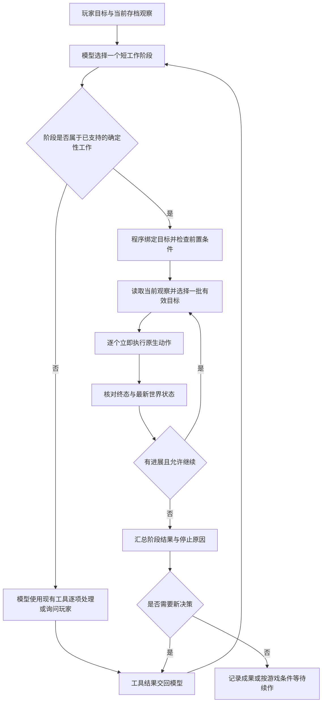

# Agent 批次工作与阶段规划方案

更新日期：2026 年 11 月 24 日

状态：阶段 A 至 E 已实施并验收，结果与正式 API 限制见[验收报告](agent-batched-work-acceptance.md)。

## 背景

玩家在连续经营测试中反馈，Agent 经常完成一个小动作后就再次等待模型，行动节奏断续，阶段规划也不够稳定。当前 `TurnRunner` 将模型工具调用逐项执行，并把全部结果送回模型继续决策。`submit_work` 通常对应一个原生动作，因此重复农活容易形成多轮模型请求。

参考 `feiyuos-stardew-ai-farmer` 的批处理、进展检查和有限恢复，以及 `feiyuos-experience-memory` 按执行证据区分完成、失败、未知与被打断的做法。

首版用现有提示词和农事指导承载经营原则。游戏观察与回执提供执行依据，Skill 模块留待实际使用数据支持后再评估。

## 目标

- 玩家给出模糊或持续经营目标后，Agent 能规划短阶段并连续完成其中规则明确的工作。
- 高频重复动作减少逐动作模型往返，降低停顿和模型用量。
- 每个游戏动作仍立即执行并复查原生终态，不增加持久化工单或长动作队列。
- 批次依据最新观察选择目标，遇到异常、无进展、控制变化或玩家新要求时及时停止。
- 保留现有八个具名模型工具入口、单角色单会话执行、F9 接管、就寝安排、读档及重连约定。
- 用现有固定实机回归和新增行为用例验证体验改进。

## 方案概览

模型根据当前观察选择一个短工作阶段，并提供农区、数量或物品去向等任务范围。运行时按内置规则核验条件、处理重复工作和常见恢复。当前批还有可以按同一规则完成的工作时，执行器根据最新观察直接续做。完成后如果还有策略选择、授权变化或规则无法覆盖的异常，再交给模型判断。

## 职责边界

### 模型

- 将长期目标拆成当前一个可执行阶段，不要求输出完整全天动作清单。
- 提供阶段类型和目标范围，例如指定照料哪片田、收多少作物、放进哪个箱子。运行时定义适用条件、完成判据和停止规则。
- 对经营优先级、资源用途、商店选择和未知游戏分支作判断。
- 根据批次汇总结果决定继续、改变策略、等待玩家或结束目标。

### TypeScript 运行时

- 保持模型可见的八个具名工具入口不变。
- 校验阶段参数与目标绑定，按目标类型调用明确的受支持工作流。
- 为阶段建立仅驻留于本次回合的执行上下文，不持久化动作队列。
- 每个子动作调用既有原生执行链，沿用动作 ID、回执结算、存档绑定、玩家新消息和 F9 检查。
- 聚合子动作结果，区分完成数量、跳过数量、失败原因、产物观察与未知终态。
- 在停止点向模型返回阶段摘要和最新观察，避免把过长的逐动作日志重复塞回上下文。

### C# 游戏执行层

- 继续负责原生移动、碰撞、动作执行及终态回执。
- 现有单次多目标动作继续使用其动作边界和核验逻辑。
- 若未来确需游戏侧批量原语，仍按单个原生动作即时执行并返回完整终态，不创建持久化后台队列。

### 提示词与农事指导

- 指示模型使用短阶段工作流，描述目标成果和受委托的范围。
- 明确有效目标必须来自当前观察。没有缺水作物时不得安排浇水，没有现存掉落物时不得安排拾取。
- 指示模型根据阶段摘要和实际剩余目标续作，不能根据计划本身推断成功。
- 继续遵守休息、保留幼树、障碍清理收益评估、F8 新要求与 F9 控制约定。

## 实施入口与首个贯通场景

在现有 `submit_work` 入口增加具名的农田照料操作，文中暂称 `tend_crops`。模型可指定观察过的农场区域或目标范围，原要求、存档、角色和游戏会话由当前回合绑定。操作仅可调用对应工作流内的已登记原生能力。先完成浇水、补水和继续浇水，再将同一执行方式扩展到收获和收纳。[companion-tools.ts](../../apps/runtime/src/tools/companion-tools.ts) · [native-tools.ts](../../apps/runtime/src/tools/native-tools.ts)

以“今天把这片菜地照料好”为例，执行器读取 `cropUnwateredTiles`，调用现有 `water_auto`，缺水时使用 `refill_watering_can`，补水后重新观察并处理剩余作物。每次原生动作仍通过 `TurnRunner.executeNative` 执行和核对，运行时在内部派动作前检查追加要求、控制权和作息。已确认处理的地块从剩余范围扣除，截断观察继续按授权区域补查。[turn-runner.ts](../../apps/runtime/src/application/turn-runner.ts)

结果至少包含阶段状态、停止原因、确认完成量、剩余范围、观察是否完整，以及可回溯的原生回执。已观察完整且无目标时可以结束阶段。观察缺失或截断且无法补查时，保留未知范围。若需汇报，可按已确认成果生成一句进展。原目标仍需经营决策时，再用阶段摘要发起模型请求。

## 首批工作流及顺序

以下工作按顺序贯通，每项单独验收。

1. **农田照料**：仅处理观察到的缺水作物；水量不足时按现有水源观察补水；不对空耕地或无作物区域发起浇水。
2. **成熟作物收获**：仅处理观察到的成熟作物；收获后依据背包、地面掉落和原生回执处理后续收集。
3. **拾取已观察物品**：只处理当前观察中确实存在且属于伙伴可收集范围的物品。
4. **收纳与出货**：使用玩家目标和当前背包、箱子观察确定物品去向；转移后检查实际库存变化。

每个工作流均应有明确前置条件、单个原生动作的目标数量上限、动作间状态核对、无进展退出条件和终态汇总。单次目标数量上限用于缩小每次派工范围。同一阶段仍有可执行目标时，程序按最新观察继续下一批。

## 执行与中断语义

- 不因“批量”延迟动作。每个游戏动作仍使用现有即时执行和回执流程。
- 批次开始前核对当前存档、游戏会话、控制权、暂停、休息时间与玩家待处理消息。
- 每个原生动作终态后更新进展。终态未知时停止批次并进入现有核对流程，不发出下一动作。
- F9 沿用即时接管与取消链路。暂停、读档和会话变化沿用现有控制语义，F8 或聊天中的新要求在下一次内部动作前接入，按新要求重新评估剩余工作。
- 动作失败后释放该动作的执行权。按实际状态决定停止或调整，不自动重放未确认动作。
- 批次没有目标或连续无进展时返回 `no-observed-targets` 或明确失败原因，避免模型把空操作当作完成。
- 到达返程或就寝边界时停止当前阶段，保留原目标与可核对进度，按现有作息规则处理。

## 目标接续与数据

继续使用现有目标、安排、动作记录与回执数据结构。阶段计划是当轮的执行上下文，阶段摘要可以写入现有目标进度字段，但不新增独立持久化工单、技能表或动作队列。每个原生子动作保留现有审计和去重记录，汇总结果必须可追溯到这些回执。

执行器负责确认阶段结果，目标完成仍沿用现有机制。持续照料目标保留到次日，并以当日工作完成或需要等待的状态记录接续条件。自动唤醒按日期、约定的游戏条件、相关观察变化或玩家新消息重新评估，避免由批次内部单条成功回执反复触发新规划。

## 失败处理

| 情况 | 处理 |
| --- | --- |
| 无观察或观察过期 | 补充对应观察；仍不可用则停止并返回未知原因 |
| 没有有效目标 | 返回无目标结果，不执行原生动作 |
| 单个目标不可达 | 沿用现有路线与障碍规则；避免同位置重复尝试，必要时停止当前批次 |
| 单动作失败 | 保留回执，按失败原因决定是否继续其他独立目标 |
| 连续没有进展 | 立即停止当前工作流，汇总证据交给模型 |
| 终态未知或通信断开 | 查询原动作和世界状态；确认前不派发后续动作 |
| 玩家新要求或接管 | 在动作边界中止旧阶段，按现有要求与控制权语义处理 |
| 状态或动作长时间无响应 | 查询当前动作和世界状态，核对后再决定是否继续。正常进展持续时允许完成阶段 |

## 可观测性与效果指标

在现有诊断事件和动作回执上记录阶段标识、阶段类型、模型请求数、原生动作数、批次目标数、实际完成数、跳过数、失败数、无进展停止原因、耗时及终态是否未知。不得记录 API Key 或不必要的完整私人对话。

用相同存档布置、目标、模型协议和流式设置对比改造前后，模拟服务和正式 API 分别记录。

- 每项固定目标的模型请求数和端到端耗时。
- 每项目标实际原生动作数、重复动作数和失败/未知终态数。
- 阶段产出与游戏最终状态的一致性。
- 玩家消息、F9、就寝和重连的边界响应。

首个贯通场景要求浇水、补水、续浇之间新增模型请求数为零，并比较整个目标的模型请求数与等待耗时。最终作物状态、接管和中断行为与回归要求同时达标。

## 验收要求

- 固定伙伴实机回归 `care-guidance`、`harvest-logistics`、`rest-forestry` 全部通过。
- 新增“无成熟作物时不收割”“无缺水作物时不浇水”“无现存掉落物时不拾取”场景。
- 大批有效目标可在阶段内连续推进，阶段结果与原生回执和游戏状态一致。
- 注入动作失败、无进展、未知终态、玩家新要求、F9、暂停、就寝和断线，均不产生越权后续动作。
- 验证 TypeScript、C#、跨语言契约与发行包。
- 实机验收使用隔离存档。不得在玩家正在运行的日常游戏上做验证。

## 参考项目的采用边界

- 借鉴 `feiyuos-stardew-ai-farmer`：高频日常步骤程序化、动作批量化、执行后看进展、有限重试与快速停止。
- 借鉴 `feiyuos-experience-memory`：动作结果需要证据、未知和中断不能误判失败、经验可信度需要验证。
- 暂不引入其固定日循环、特定账号/存档路径、环境桥接、独立 Python 归纳器、SKILL.md 生成或自动技能升级。
- 后续若实测显示跨多个目标重复出现同一有效策略，再单独评估经验检索或 Skill 模块，并以本方案积累的回执数据作为证据来源。
