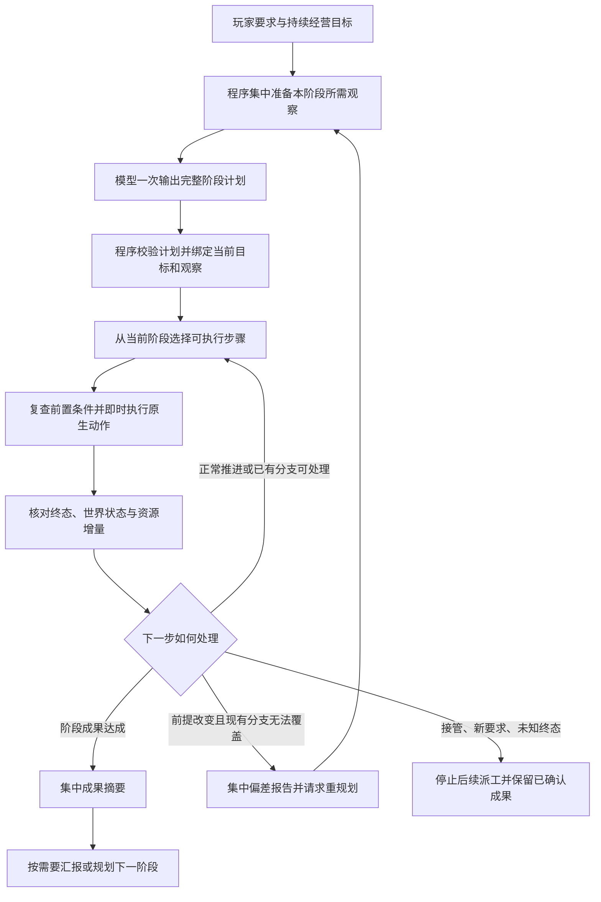

# Agent 完整阶段规划与连续执行方案

更新日期：2026 年 11 月 25 日。状态：A～F 已实施并验收完成；任务见[实施 TODO](agent-phase-planning-todo.md)，证据、网关限流与正式协议限制见[实施与验收记录](agent-phase-planning-acceptance.md)。

### 实施进度

| 阶段 | 当前结果 | 提交 |
| --- | --- | --- |
| A：基线与契约 | 固化旧版样本，定义完整计划及授权边界 | `122647d` |
| B：全图观察与缓存 | 分页观察、地图指纹、设施与补水缓存 | `a04d7a8` |
| C：完整阶段执行器 | 采木、收集、入库贯通，模拟实机验证执行期零模型请求 | `2fe063c` |
| D：请求组织与集中反馈 | 稳定前缀、确认送达增量、真实用量与缓存指标 | `60792a8` |
| E：日常链路与桌面体验 | 日常多步骤计划、GUI 阶段成果、提示词与说明 | `45f4e0e` |
| F：验收与发行 | 自动化、最终包模拟及正式完整阶段、缓存与控制实机通过；文件/入口/许可核验完成 | 本轮收尾提交 |

下文的“现状与缺口”保留改造前基线。最终包完整日常及远树采木各以两次正式请求完成；普通目标仍可能走旧工具链，不能宣称所有场景稳定两次请求或均降低 Token。设计范围、行为边界和已知限制以验收记录为准。

## 1. 目标与范围

将模型的决策单位从“下一步动作或单类农活”提升为“有明确成果的完整工作阶段”：程序集中准备观察，模型一次规划阶段的流程、资源边界和条件分支，程序连续执行，阶段结束或关键前提变化后集中反馈。执行中持续核对游戏状态，正常步骤之间不调用模型。

首批贯通“采木 → 收集 → 入库”和“日常照料 → 收获 → 收集 → 入库”。阶段可以包含多种操作，由模型事先安排依赖与失败分支；不能仅把当前单动作包装成另一个固定工具，就声称完成了完整规划。Skill、模型生成脚本与持久化工单不在本次范围。

### 产品目标

- 一次规划覆盖一个完整成果，例如补充一批木材并存进箱子，而非每砍一棵树就询问模型。
- 全图候选、交互站位和具体路线由程序发现和计算，模型负责目标、顺序、资源分配与例外策略。
- 地图和设施观察可缓存复用，避免反复全图扫描与重复传输相同坐标。
- 上下文按稳定前缀与变化信息组织，减少重复输入，利用供应商实际提供的缓存能力。
- 两种游玩模式、聊天和工作共用现有回合、状态和原生链路。玩家新要求及时生效，执行中断后不自动回放旧计划。

### 明确边界

“一次规划”是集中观察准备完成后，正常阶段的一次模型规划请求；首版允许完成后再调用一次模型汇报或规划下一阶段。异常重规划、网络重试分别计数，不能隐藏在“一次调用”中。

计划是当前回合内的有限决策结构，立即解释并逐项派发动作；不预先创建整天的动作对象、持久化队列或后台任务。地图知识可存储，执行计划不能在重启、读档或接管后自动恢复。真实失败、未知回执和授权变化优先于预先规划。

## 2. 现状与具体缺口

本方案基于 `1df1388`。此前批次工作和持续经营修复仍然有效，见[批次工作验收](agent-batched-work-acceptance.md)和[持续经营验收](ongoing-farm-planning-acceptance.md)。

| 当前实现 | 已有能力 | 本次缺口 |
| --- | --- | --- |
| `submit_work` 工作流 | 照料阶段内部补水续浇，批量收获、拾取、入库、出货 | 多类操作之间仍通常回到模型，缺少完整阶段计划与条件分支 |
| `chop_tree` | 一次可传多个树木坐标，并校验成熟与未装采集器 | 无全图候选准备、阶段目标量控制及采伐后的收集入库衔接 |
| 常规树木快照 | 人物周围半径 16 格，最多报告 24 棵 | 局部为空不能代表全图为空，模型容易逐段补查 |
| `collect_ground_items` | 程序反复观察、拾取并核对背包 | 尚未结合采伐访问顺序和产物范围进行整体安排 |
| `refillCan` / `FindWaterRefillTiles` | 专项寻找当前地图原生水源，补满即结束 | 照料补水会重新扫描；当前专项搜索为半径 96，不能笼统当作任意地图完整扫描 |
| `WorldMapGraph` | 已缓存地图连接关系并按指纹失效 | 缺少统一的水源、设施与观察完整性缓存边界 |
| `PiModelAdapter` | 支持用量中的 `cacheRead` / `cacheWrite` | 每次将变化中的项目状态拼入系统提示词，影响其后消息前缀的复用 |
| `TurnRunner` | 单回合执行、原生回执核对、增量状态、接续检查 | 需接入整阶段结果，避免把阶段内部观察逐条送回模型 |

主要入口：`apps/runtime/src/application/turn-runner.ts`、`apps/runtime/src/tools/companion-tools.ts`、`apps/runtime/src/tools/native-tools.ts`、`apps/runtime/src/adapters/model/pi-model.ts`，以及 Mod 的 `CompanionMechanicsCoordinator`、`GameWorldObserver` 和 `Navigation`。

### 2.1 farmer 参考实现与采用方式

本轮只读核对本机 `farmer` 下两个项目的源码，未运行其脚本或验证 README 中的实机成绩。参考版本：`feiyuos-stardew-ai-farmer` 的 `e58e70c764c8615e20a9da2f2ac0f45be5fb2873`、`feiyuos-experience-memory` 的 `22e32a1c1105d3cdec2fbc0fd2d5d35c391522e5`；下表使用固定提交链接，避免后续代码变化使参考失真。

| 参考源码 | 可采用的做法 | 当前项目落地与限制 | 对应任务 |
| --- | --- | --- | --- |
| [world-map.mjs：makeWorld / grid](https://github.com/YeStarOne/feiyuos-stardew-ai-farmer/blob/e58e70c764c8615e20a9da2f2ac0f45be5fb2873/src/world-map.mjs#L13) | 地图数据层独立于行动决策，分块读取后合并，分别缓存出口、门和可走图 | 改为读取实际宽高、显式分页完整性，按存档和内容版本隔离；原实现 96 格分块、最多 6 行/列及 10 分钟 TTL 不能直接当作通用完整性和新鲜度保证。不沿用对未探索地图无条件远程读取的方式 | PP-04～PP-07 |
| [lib.mjs：waterAll](https://github.com/YeStarOne/feiyuos-stardew-ai-farmer/blob/e58e70c764c8615e20a9da2f2ac0f45be5fb2873/src/lib.mjs#L142) | 批量处理后复查剩余量，缺水补水，按进展选择继续或有限恢复 | 复用本项目已有照料阶段；继续核对真实缺水作物与原生终态，不因 HTTP 超时就回退重做，不以固定轮数代替无进展判断 | PP-09、PP-12、PP-17 |
| [lib.mjs：chopWood](https://github.com/YeStarOne/feiyuos-stardew-ai-farmer/blob/e58e70c764c8615e20a9da2f2ac0f45be5fb2873/src/lib.mjs#L598) | 目标木材量、体力下限由参数传入，程序连续砍树并回读背包 | 区分木材件数与树木数量，以真实材料量终止；用全图成熟树候选和动态拾取取代附近树列表及末尾固定坐标巡回。保护幼树、果树和采集器树，目标前检查资源预算 | PP-08、PP-10、PP-11 |
| [lib.mjs：harvestAll / sweepDebris](https://github.com/YeStarOne/feiyuos-stardew-ai-farmer/blob/e58e70c764c8615e20a9da2f2ac0f45be5fb2873/src/lib.mjs#L493) | 收获与补捡串联；复查现存掉落物、背包增量，暂记卡住目标并换点 | 按原生物品 ID、质量及回执核对，不能只按英文名称或整体正增量归因。没有背包增量不代表没有成熟作物；`droppedBy===0` 也不能直接等价为伙伴产物或授权。使用阶段结果与玩家要求绑定收集范围 | PP-03、PP-11、PP-12、PP-20 |
| [craft-smelt.mjs：getFurnaces / standAt](https://github.com/YeStarOne/feiyuos-stardew-ai-farmer/blob/e58e70c764c8615e20a9da2f2ac0f45be5fb2873/src/craft-smelt.mjs#L20) | 动态发现机器，尝试设施周边的交互站位 | 提取为通用设施发现和原生站位能力，首批用于箱子与水源；原脚本仍有固定进屋坐标和时间推进操作，本轮不移植熔炼业务 | PP-06、PP-07、PP-10 |
| [day-loop.mjs：playOneDay](https://github.com/YeStarOne/feiyuos-stardew-ai-farmer/blob/e58e70c764c8615e20a9da2f2ac0f45be5fb2873/src/day-loop.mjs#L127) | 一次运行串联多种操作，背包和资源状态决定内部处理分支 | 参考步骤衔接和前置条件；日常优先级由模型完整阶段计划决定，不照搬固定全天日程、独立守卫进程或跨日循环 | PP-02、PP-09、PP-13、PP-17 |
| [lib.mjs：compactState / stateDelta](https://github.com/YeStarOne/feiyuos-stardew-ai-farmer/blob/e58e70c764c8615e20a9da2f2ac0f45be5fb2873/src/lib.mjs#L898) | 精简状态与只记录变化，减少重复日志 | 这两处主要面向日志，不能认定已经实现模型请求增量或供应商缓存；本项目仍需实现稳定前缀、确认送达基线和协议验证 | PP-14～PP-16 |
| [expmem/outcome.py：classify_episode](https://github.com/YeStarOne/feiyuos-experience-memory/blob/22e32a1c1105d3cdec2fbc0fd2d5d35c391522e5/expmem/outcome.py#L77) | 区分成功、失败、未知与中断，正效果与写后观察共同构成证据 | 使用本项目结构化原生回执及前后状态，不移植日志正则判定器。它也明确尚未解决目标与动作的完整语义匹配；我们的成功必须核对本阶段具体成果，不能任意写动作成功就标整阶段完成 | PP-03、PP-11、PP-15、PP-20 |

这两个项目提供程序化执行与证据核对的实践参考，所查看的核心流程主要由预编写脚本编排；不能据此声称已有可直接复用的“模型一次生成完整阶段计划”执行器，也未在所核对模块中发现可直接采用的供应商提示词缓存实现。下一步仍需自行实现有类型的计划、校验、结果绑定和生命周期控制。

### 2.2 不直接移植的实现

- `/queue` 的预生成移动、朝向与使用命令序列：借鉴减少中间模型介入的思想，执行仍由当前回合逐动作派发和核验，不形成失效后继续运行的长队列。
- 固定坐标巡回拾取、硬编码农场/设施布局、固定背包容量：替换为原生动态观察、实际容量和路径检查。
- 传送、刷物品、强行推进时间，以及依靠重启/守卫脚本维持运行：不作为本项目正常经营的补偿路径，继续使用原生步行、资源和作息链路。
- 经验卡生成与自动递卡：本轮只采用可解释的成果判据，不引入 Python 运行依赖或提前落地 Skill 模块。

以设计和行为借鉴为主。若实施时决定复制或改编源码，先核对所用版本的许可、具体文件版权及依赖声明，按要求更新 `NOTICE` 与第三方许可；不能把参考代码与其桥接依赖直接塞进发行包。

## 3. 运行流程

集中观察是程序发起的只读游戏查询，不需要先调用一次模型来决定查询每一张表。根据玩家要求、当前目标、已有当天计划和可执行能力选择观察组合；模糊经营先提供资源与可行机会摘要。模型确需额外信息时仍可查询，但计为额外规划请求，不强行用不完整信息维持“一次”。

## 4. 集中观察与地图知识

### 4.1 规划观察包

运行时组装一个有版本的 `PhaseObservation`，至少包含：

- 存档、角色模式、游戏会话、日期、观察版本及玩家要求版本，均由程序绑定。
- 原始长期目标、最新追加要求、保留约定及当前阶段允许的操作。
- 时间、作息返程边界、体力与工具、水量、背包、资金，以及相关箱子库存和容量。
- 所需范围内的作物、成熟树、现存可拾取物、水源、设施和路线候选摘要。
- 各观察项的地图、范围、完整性、截断标记、版本与缺失原因。
- 当前可行工作、局部障碍和待确认信息，不把历史失败转成永久禁止。

精确坐标和原生对象绑定留在程序的候选集合中。模型默认接收分组数量、区域、预计路程与成本范围、保留规则和引用标识；需要精细取舍时可附选定候选的坐标与属性，不默认输出全图实体和逐格碰撞矩阵。估算值明确为估算，不能冒充收益承诺。

### 4.2 真正的全图观察

原生地图查询按实际宽高遍历或按区域分页，不使用固定半径冒充全图。树木优先遍历原生实体集合，水源按地图边界扫描；较重扫描在主线程分批读取，不阻塞单帧，不从后台线程并发读取可变游戏对象。

分页返回范围、候选、下一页和完整性。跨多帧世界发生相关变化时，标明混合版本并补查受影响部分，不能据未完成扫描宣称“全图没有树”。运行时合并分页，再给模型一份整理后的观察包。

只扫描原生层可合法观察的地图。AI 自玩继续遵守现有玩家知识边界；未加载、未到达或不允许观察的地点标为未知，不能为了全图规划绕过限制。

### 4.3 缓存分层

| 层次 | 内容 | 生命周期与失效 |
| --- | --- | --- |
| 地图基础知识 | 水源区域、地图出口及已发现的固定交互位置 | 按存档、地图标识、模式及可用地图/内容指纹隔离；读档和内容重载复核，无法判断指纹时保守重扫 |
| 可变设施 | 箱子、床、建筑、井等位置与交互点 | 新建、移动、拆除、改图后失效；使用前核对对象类型、身份和交互条件 |
| 阶段候选 | 树木、作物、可收集物及可达候选 | 当前阶段内存；相关动作、玩家改动或过期后局部复查，不跨日当作现状 |
| 路线 | 候选顺序、分段路径及局部失败 | 短期复用；站立格和格点间原生碰撞逐步检查，受阻后失效或重算 |

水源缓存保存可用水域与岸边候选，查询时按当前位置和实际可达性选择，不仅记住上次的一个坐标。缓存命中后仍调用原生补水判定；点位失效时尝试同源其他岸边，再补查其他水源，常规恢复不需要模型参与。

持久化只保存可重建的派生地图知识，可利用现有 SQLite 适配器新增独立缓存数据；不写入角色记忆和玩家约定。缓存损坏可丢弃重建。读档重建当前世界观察，旧磁盘缓存仅用于加速候选发现，验证后才能使用。掉落物不持久化；箱子坐标不代表库存未变；地图出口坐标不代表通路和解锁状态未变。

## 5. 模型一次输出什么

在八个具名入口不变的前提下，为 `submit_work` 增加 `execute_phase` 操作。模型输出结构化阶段计划，其他工具仍可聊天、观察、咨询、维护安排与请求玩家决定，不新增专用规划会话或只读回合。

计划首版包含：

| 字段 | 责任 |
| --- | --- |
| `objective` | 本阶段成果，例如储备木材并入库；具体类型由 completion.metric 表达 |
| `observation_ref` | 引用程序当前观察包；程序校验会话、地图、版本和授权绑定 |
| `scope_ref` / `constraints.destination_ref` | 引用当前观察范围和箱子，不允许用引用扩大授权；首版范围为已知 Farm 当前地图 |
| `completion` | 支持的成果判据，例如本阶段新增木材目标量、作物照料完成及产物入库 |
| `constraints` | 体力下限、物品保留量、显式选择已授权的现有材料及设施去向；不提供关闭保护或任意清障的开关 |
| `steps` | 有依赖顺序的操作步骤，各有完成判据和结果引用 |
| `branches` | 可预先判断的局部失败处理及触发条件 |

原要求、存档、目标和角色身份不接受模型自填。程序约束和玩家保留约定优先，模型不能通过 `constraints` 放宽已有保护。资源“新增 60 木材”和“库存补足至 60 木材”是不同判据，schema 与展示必须区分；掉落随机性与单棵树产量导致的合理超额由摘要说明，不假定精确产出。

### 5.1 支持有限结构，避免引入脚本语言

首版采用有类型的步骤和依赖，不实现任意代码、表达式、递归或模型自行构造的无限循环。先限制每阶段最多 8 个语义步骤、4 个例外分支，支持采伐、照料、收获、收集、入库及其必要的移动/补水；每个步骤内部可按最新观察重复处理多个目标。步骤数量上限约束计划复杂度，不按总工作时长打断有进展的任务。

条件为枚举，例如目标已达成、背包容量不足、候选不可达、资源不足、设施失效。运行时提供类型明确的结果绑定：后续收集引用前面采伐区域和真实掉落观察，入库引用真实新增物品及被授权的原有物品；不由模型发明物品数量或把引用变成文本求值。

预算用于选择下一棵树前检查，不允许动作执行到一半为满足估算而伪报成功。体力不足按既有恢复能力和预先允许的策略处理；无对应策略时集中返回重规划。就寝控制器与玩家接管拥有更高优先级。

### 5.2 首个完整阶段例子

玩家要求“今天照料后补充一批木材，保留幼树并收进箱子”。集中观察提供缺水作物、两组成熟树、背包和箱子、水源、体力与返程约束；模型一次安排：

1. 照料当前作物，缺水由程序自行补水续浇。
2. 在授权成熟树组内采伐，按目标木材量和保留体力选择下一棵。
3. 顺路吸取，完成邻近树组后复查剩余掉落物并集中收集。
4. 将本阶段采集材料存入已指定箱子，核对背包与箱子增量。

预先约定分支：单树不可达则暂记局部受阻并换候选；背包紧张则先入库再继续原成果；箱子不可用且无授权备用箱则停下重规划；原生动作未知终态则先核对，不换树继续。不是“先砍一棵，再问模型该不该拾取”。

阶段候选顺序是建议，具体路径由程序随世界变化重算；进程退出、中断或跨日后丢弃未执行计划，按已确认成果重新规划剩余工作。

## 6. 连续执行与有限恢复

TypeScript `PhaseExecutor` 管理语义步骤、资源和结果绑定，复用现有批次工作流。C# 负责权威扫描、对象检查、碰撞、导航和原生动作；复杂新逻辑不继续堆入 `TurnRunner` 或 `CompanionTools`。

建议在运行时 application 下按职责拆分阶段计划契约、观察准备、计划校验、阶段执行和结果汇总；storage 管理派生地图缓存。`TurnRunner` 继续掌管单会话与模型循环，`CompanionTools` 负责入口校验和委托。实现时按实际复杂度拆文件，不新增并行调度器。

### 路线与收集

程序结合到达交互站位的路径成本、候选密度、体力和箱子位置排序；先用局部最短访问及有限改进，不要求全局旅行商最优解。计算本身设置工作量预算，后台计算只使用主线程生成的不可变地图样本。

不强制全图所有树砍完才拾取。支持按树组交错采伐与收集，自动吸入的物品通过背包变化识别。收集时读取现存掉落物，不重复走最初缓存的旧坐标；地面空、伙伴背包增加、玩家吸走、物品不可达分别记录，不把地面空直接记成已收集。

### 哪些情况不调用模型

- 同一授权范围内选下一有效目标、补水换岸边、自动吸取、局部重排路线。
- 当前树消失或单点不可达，但还有符合既定规则的候选。
- 按预设箱子、已授权保留量和真实产物进行入库。
- 分页观察、缓存刷新、终态查询与已确定参数错误的拒绝处理。

### 哪些情况交回模型或玩家

- 无法达到阶段目标，资源用途、授权范围或经营优先级需要改变。
- 所有允许候选/备用设施耗尽，或局部失败已使原计划不成立。
- 收到玩家新要求、读档、跨日或游戏会话变化；旧阶段停止后重新组织上下文。
- 未知终态先走既有核对流程，核对之前不派后续动作；需要玩家处理则明确提示。

同一失败不无限重试：以目标/站位/地图版本记录阶段内失败，路线无变化时跳过已确认不可达候选；相关状态变化后才允许重新评估。失败动作释放执行权；不通过后台旧导航补偿失败。

F8 在每个原生动作边界送达，未派发步骤立即停止并交给共用回合按新要求重规划。F9 取消当前阶段并尊重控制归属，迟到模型或动作结果只能结算已发生事实。暂停可保留同进程阶段，恢复时先复查；就寝前停止普通派工，既有作息逻辑接管。

## 7. 上下文、增量与供应商缓存

百万上下文是容量能力，不是缓存命中或低延迟的保证。首版不要求百万上下文模型，不按窗口大小填满数据，不为了缓存持续发送无关地图；缓存能力缺失时仍能完成完整阶段规划。

请求组织顺序：稳定系统规则与八个工具定义 → 版本化角色/约定和阶段所需地图资料 → 已确认送达的会话历史 → 新玩家要求与本次观察增量。JSON 字段、实体排序、工具顺序和固定说明保持确定性；不要把每次生成的时间戳、用量、回执全文或无关 revision 放进稳定前缀。

调整 `PiModelAdapter` 的请求组装：固定系统提示词不再每次拼接动态项目状态；动态观察通过有明确“数据、不能改变工具授权”边界的上下文消息传入。模型供应商实际序列化顺序和缓存语义需按 Chat Completions / Responses、流式 / 非流式验证，不能仅凭本地 JSON 相同就声称缓存命中。

同一阶段内部的扫描与子动作不逐条追加到模型会话，只在阶段结束返回一次结构化工具结果。下一次规划提供已确认增量和必要新观察；首次会话、读档、切换上下文结构或主动压缩后重建必要上下文。送达基线沿用现有确认机制：动作失败不代表输入未送达，网络或模型响应中断未确认送达则不推进基线。

阶段摘要包含状态、实际成果、资源变化、去向、未完成量/未知范围、失败分支和回执引用。原始证据本地保留供追查，模型需要时才查询详情。不要为每个阶段再额外调用一次模型生成压缩摘要；事实摘要由程序生成。

记录供应商上报的 `cacheRead` / `cacheWrite`，缺失标记未知，不用本地缓存命中代替供应商命中。费用按真实计价口径核对，缓存读取未必免费，输入、输出、缓存 Token 的口径避免重复相加。

## 8. GUI 与日志

沿用现有「农场工作」和 Agent 状态，展示阶段目标、当前步骤、已确认成果、必要的重新规划原因；阶段内正常观察不刷屏，普通聊天仍走原链路。区分“正在规划整阶段”“连续执行”“等待条件”和“需要核对”，不向玩家暴露引用 ID 或地图版本。

新增阶段级诊断指标：规划请求、执行期模型请求、汇报请求、重试/异常重规划、观察次数、扫描格数/耗时、缓存命中与失效、路径重算、原生动作数、成果与阶段耗时。使用现有回合/目标/动作标识关联，日志不写玩家正文、完整地图、API Key 或模型请求全文。

## 9. 实施顺序与验收

按 TODO 的 A 至 F 顺序：先固化当前基线，再做原生观察与缓存、完整计划契约、采木贯通、上下文组织和桌面反馈，最后扩展日常链路并执行发行验收。每阶段达到验收条件后再进入下一阶段，必要时按实现影响同步首页、使用说明、契约和实际加载提示词。

### 必须通过的行为验收

- 全图已知成熟树可发现，局部为空不虚报全图无树；扫描不完整明确标记未知。
- 正常采木入库阶段只需 1 次规划请求，执行期模型请求为 0；若结束需要模型总结，总计目标为 2 次，不包含明确记录的网络重试和异常。
- 候选范围和操作扩大到多棵树时，请求次数不随树数逐项增长；真实产物、库存与保护对象正确。
- 补水缓存冷/热查询结果正确，热命中减少完整扫描，岸边被挡或水源失效能局部恢复；不保证没有路径计算。
- 本阶段内全图物品观察与执行相互独立，不把观察/寻路工具调用数等同于模型请求数。
- F8、F9、暂停、就寝、读档、跨日、重连、未知终态与迟到回执均维持现有边界，不重复派工。
- Chat Completions 与 Responses 的流式/非流式共用相同规划能力，不支持供应商缓存时正常运行。

### 效率验证方法

用同源隔离存档、同一目标和同一模型/协议对比改造前后采木入库、补水续浇、收获物流；至少记录 3 次重复样本的请求次数、模型等待时间、输入输出及缓存用量、端到端耗时、实际成果和失败。采木场景区分多目标原生旧接口基线和模型实际逐步派工，不能故意只用最差旧行为作为对照。

模拟服务用于确定性验证“一次完整计划覆盖后续多步且中途无模型调用”；正式 API 验证模型能自主生成有效计划。性能样本将成功、失败、冷缓存和热缓存分开，不以单次缓存波动宣称改善。缓存命中不作硬性承诺；正常执行期零模型请求、成果正确和控制边界是硬性门槛。

跑固定的 `care-guidance`、`harvest-logistics`、`rest-forestry` 三组隔离实机回归，新增阶段规划、缓存失效和完整采木场景；独立核验结果、碰撞与动画。验证 TypeScript、C#、一次生成的跨语言契约样本、桌面、文档和绿色包。未执行或凭据不可用如实记录。

## 10. 本次不实施的扩展

不引入通用 Agent 脚本、持久化全天动作队列、自动生成 Skill、跨角色并发、直播业务或插件业务。采购、建设等有价格和授权决策的复杂阶段留待首批验收后扩展。日后扩展仍通过有类型步骤、观察和原生能力接入，不靠无限增加提示词维持运行。
