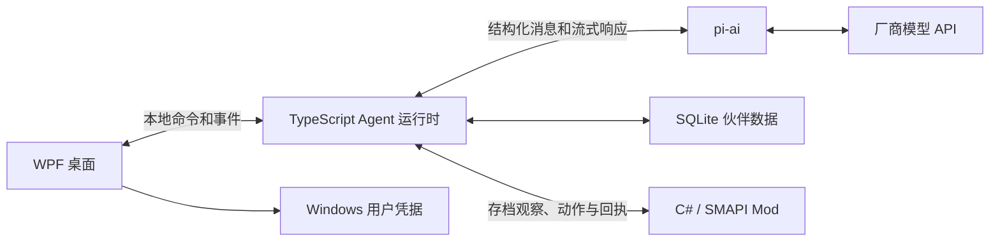

# TypeScript Agent 运行时改造方案

星露谷游戏伴侣将内置 TypeScript 运行时，通过 Pi 的模型 SDK 直连厂商 API。玩家从绿色包启动桌面程序，在「模型」中选择服务商、填写 API Key 和模型，即可进入游戏。实施顺序、依赖和验收条件见 [改造 TODO](agent-runtime-rewrite-todo.md)。

## 1. 改造范围

- **替换生产 Agent 运行时。** TypeScript 接管模型接入、回合执行、上下文、持续目标、伙伴数据、桌面 API 和游戏通信。首版使用 `@earendil-works/pi-ai`，由项目驱动回合。
- **沿用桌面和原生游戏能力。** WPF 继续负责设置、对话、状态、控制和托盘。C# / SMAPI Mod 继续负责世界观察、游戏主线程上的动作、碰撞、动画、游戏时钟和玩家接管。
- **新数据、新内部契约。** 伴侣数据从新库开始，桌面、运行时与 Mod 同版本交付。本次允许移除旧伴侣数据导入、旧客户端接口和原会话接续。玩家的《星露谷物语》存档继续由游戏管理。
- **开发分段替换，发布一次切换。** 旧运行时在开发期间用于复现和对照。新绿色包通过验收后，移除生产 Python Agent、CLI 适配器及其打包依赖。独立的开发脚本按用途保留。

本方案接替[上一轮架构实施方案](architecture-refactor.md)中有关 Python 运行时、外部客户端和旧兼容的约定。实施时同步更新仓库约定、首页、使用说明、生产提示词和验收入口。

## 2. 组件职责



| 组件 | 职责 |
| --- | --- |
| WPF 桌面 | 保存模型配置和凭据，启动随包 Node，展示连接、回合和动作状态，处理托盘和桌面退出。 |
| Agent 运行时 | 组装游戏上下文，驱动模型回合，调度游戏工具，管理持续目标、对话、记忆、玩家选择与用量。 |
| 模型适配层 | 将项目的消息和工具定义交给 `pi-ai`，转换流式文本、工具调用、完成原因、错误和用量。模型包类型留在适配层。 |
| SMAPI Mod | 从当前游戏实例取得观察并执行原生动作。游戏主线程校验执行权，返回动作终态和实际效果。 |
| 本地数据 | 保存按存档关联的伙伴设定、记忆、对话、安排、回执索引和用量。API Key 单独由 Windows 凭据存储管理。 |

建议最终使用以下目录。开发期可用临时目录并行验证，切换时把 TS 运行时归位到 `apps/runtime/`。

```text
apps/
  desktop/src/                 WPF、模型设置、凭据与运行时宿主
  runtime/
    src/
      application/             回合、读档、持续目标和对话投递
      domain/                  伙伴数据、控制权与执行回执语义
      tools/                   八个游戏工具的定义、校验和调度
      adapters/
        model/                 pi-ai 与服务商配置
        desktop/               桌面命令、查询和事件
        game/                  与 Mod 通信和动作回执核对
        storage/               SQLite 持久化
    tests/
  game-mod/src/                SMAPI 与原生游戏操作
contracts/
  desktop-api/
  game-bridge/
resources/agent/               游戏提示词、领域指导和可用技能
packaging/windows/             Windows 绿色包构建、校验与启动验证
```

## 3. Pi SDK 与模型接入

首版锁定 `pi-ai` 和生产依赖，使用项目自有回合执行器。DeepSeek 官方 API 与 OpenAI Responses API 作为首批验收对象，用两种协议验证结构化工具调用、流式用量和取消。后续按实际支持接入 MiniMax、Anthropic、Gemini 及自定义兼容服务。服务商目录只列入通过相应用例的模型或接入类型。

模型适配接口接收服务商、模型、推理档位、结构化消息、工具定义和取消信号。返回规范化的文本、已完整解析的工具调用、终止原因、用量与错误。仅在所属厂商回合内传递其协议要求的工具关联或推理字段。设置页区分鉴权失败、模型不可用、限流、网络超时和工具调用能力不足。用量缺失显示「未记录」。

`pi-agent-core` 放在单独的评估任务中。它提供顺序执行、工具前置检查和取消，评估时须通过 F9、追加要求、原生动作超时以及待确认事项的用例。若采用，控制权校验、动作终态核对和持久化仍由项目负责。绿色包以 WPF 为入口，随附 Node 和所选 Pi 库。

当前 `pi-ai` 的主分支声明 Node.js 22.19 或更新版本。实施时以锁定的 npm 发行版为准，在干净 Windows 环境验证其 Node 版本、依赖加载和许可证清单。[Pi 模型 SDK](https://github.com/earendil-works/pi/tree/main/packages/ai) · [Pi Agent Core](https://github.com/earendil-works/pi/tree/main/packages/agent) · [上游包配置](https://github.com/earendil-works/pi/blob/main/packages/ai/package.json)

## 4. 回合与原生执行

1. **接收要求。** 桌面对话、游戏内对话、玩家补充要求和自主续作进入同一个回合服务。每个角色同一时刻只有一个执行中的回合，由运行时关联当前存档、游戏会话和目标。
2. **组装上下文。** 从项目读取角色、相关记忆、近期对话、当前目标和经确认的游戏观察。按回执更新上下文状态。对需要完整请求的厂商 API，由运行时重建本轮消息与必要的工具结果；读档或主动压缩后重新建立观察基线。
3. **验证并执行工具。** 只向模型发布现有八个具名工具。流式工具参数收齐后再验证，游戏动作按顺序执行。派工目标、当前存档和控制权由程序绑定。每次工具执行前重新检查忙碌、暂停、接管和会话有效性，在工具边界纳入玩家新增要求。
4. **核对并回报。** 以原生回执和观察为准更新状态，已完成的动作只结算一次。正式聊天消息按关联 ID 投递到游戏和桌面，流式进度仅作为当前回合的展示。等待玩家决定时保存选项与原请求的关联，收到选项后立即保存。

保留现有的 `get_status`、`query_game`、`submit_work`、`manage_arrangements`、`remember`、`request_player_decision`、`consult`、`read_reload_history`。把定义、校验和实现移到 TS 游戏工具模块，供回合直接调用。信息来源继续限于游戏工具以及 `consult` 提供的指导和 Wiki。[现有工具定义](../../apps/runtime/src/stardew_ai_runtime/game_tools.py)

**暂停、改派和接管。** F9 由 Mod 立即交回控制权，运行时取消模型请求，并等待或查询原生动作终态。旧回合的迟到响应到达后，按会话和回合校验结果拦截。改派在旧动作终态确认后继续，根据已完成成果决定剩余工作。回执缺失期间保持待核对状态。运行时限制无响应间隔，持续有进展的正常工作按现有规则推进。动作仍即时执行，不增加持久化动作队列。

**读档和重连。** 读档更新游戏会话并重新观察，按新存档中的事实核对目标。旧动作和迟到响应无法跨存档生效。运行时在当前游戏中重连时沿用项目的对话身份，先核对旧动作和当前控制权，再依据玩家的明确操作继续。

## 5. 数据、桌面和绿色包

- **数据源。** 新 SQLite 库由 TS 运行时负责写入。以存档标识关联角色与长期对话，以游戏会话和动作 ID 关联临时执行。目标、玩家选择和已确认进度需要持久化，断线后从这些数据以及游戏观察恢复。更换模型时由本项目重建上下文，继续使用同一角色、记忆和目标。具体 SQLite 驱动在绿色包样机上验证后锁定。
- **设置与凭据。** 日常设置显示「服务商」「API Key」「模型」「测试连接」，推理档位按模型能力出现，自定义兼容接入才显示 Base URL。测试连接在进入游戏前可用。普通配置和伴侣数据留在解压目录的 `data/`，Key 存入当前 Windows 用户凭据，复制到另一台电脑时重新填写。运行时通过受控的本地通道取得所需凭据，模型密钥与本地服务鉴权分开。
- **内部协议。** 重新整理 WPF ↔ TS 的命令、状态与事件，以及 TS ↔ Mod 的游戏绑定、观察、动作、取消和回执。双方启动时交换协议版本，使用存档、游戏会话和请求 ID 校验对应关系。游戏内启动路径继续用于源码调试与隔离验收。
- **发布。** EXE 继续是根目录唯一玩家入口，随包提供 Windows x64 Node、运行时代码与依赖、Mod、提示词、完整性清单和许可。包在没有全局 Node、Python 或模型客户端的 Windows 环境验收。升级发布前用独立目录验证，旧版程序目录与游戏存档保留，可通过重新打开旧版目录回退。

## 6. 发布验收

- **可启动可执行。** 绿色包解压后，只填服务商、Key 和模型，进入隔离单人存档，提交一句自然语言并收到对应的原生动作回执。
- **可接管可恢复。** 覆盖模型流中断、F9、改派、原生动作回执丢失、读档和同一游戏内重连。核对已有成果、控制权、回执去重和续作状态。
- **可更换模型。** 同一存档完成一次 DeepSeek 与 OpenAI 的切换，验证伙伴名字、记忆、历史、状态和未完成目标的连续性。
- **玩法回归。** 沿用 `care-guidance`、`harvest-logistics`、`rest-forestry` 的自然语言任务和游戏证据，验收入口改走新运行时。分别核对动作结果、物品、碰撞、动画和等待状态。[固定实机任务](../repeatable-companion-acceptance.md)
