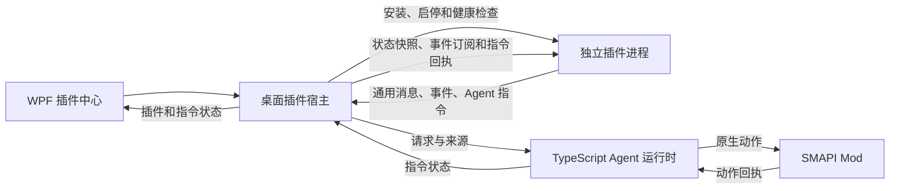

# 桌面插件中心与第三方服务托管方案

状态为设计草案，面向星露谷游戏伴侣的后续 0.x 迭代。

按依赖排序的任务、交付物和验收条件见[实施 TODO](desktop-plugin-platform-todo.md)。

首版接口字段、包约束和 Agent 受理细则以[插件宿主 v1 契约](../../contracts/plugin-host/v1.md)为准。

桌面启动器是绿色包的统一入口。玩家在 GUI 里安装、启停插件，从插件卡片进入插件自己的配置界面。独立插件可以订阅游戏和 Agent 事件，也可以提交自然语言指令。插件启用后默认拥有宿主公开插件接口的全部权限，宿主提供统一的协议与生命周期管理。

平台交付范围是通用插件能力，验收使用两个参考插件。直播和 Live2D 仅用于说明接入方式，不纳入实施和验收。

## 职责与依赖

| 组件 | 职责 |
| --- | --- |
| WPF 插件中心 | 展示已安装插件、版本、启用状态、进程与连接状态。提供安装、更新、启动、停止、打开插件设置和打开日志目录的入口。 |
| 桌面插件宿主 | 管理清单、运行目录、进程所有权、协议握手、健康检查、运行实例鉴权、请求去重和状态查询。由宿主统一调用 Agent 提交服务。 |
| 独立插件 | 自行处理外部服务、账号、规则、界面与反馈。按需订阅宿主事件、报告状态或提交已生成的自然语言指令。 |
| TypeScript Agent 运行时 | 绑定当前游戏会话，协调现有回合、目标、暂停、接管、工具调用和结果核对。 |
| SMAPI Mod | 在游戏主线程读取世界、执行原生动作并返回回执。现有八个具名工具和游戏内扩展机制沿用自身契约。 |



宿主的进程管理、协议处理和 Agent 转交分别放在独立于 WPF 控件的应用服务中，可分别用假进程和假 Agent 测试。现阶段都由桌面程序组装，最小化到托盘时继续工作。现有桌面会话仍负责游戏与 Agent 的配对和退出，通用的进程启动、健康检查和退出代码可逐步复用。外部插件用自己的协议和凭据接入，宿主内部走现有桌面 API 的应用层提交链路。[桌面会话](../../apps/desktop/src/DesktopSession.cs) · [桌面进程](../../apps/desktop/src/DesktopProcesses.cs) · [桌面 API](../../contracts/desktop-api/v2.md) · [Mod 扩展宿主](../../apps/game-mod/src/Extensions/GameExtensionHost.cs)

## 插件中心与配置入口

左侧新增「插件中心」。列表显示插件名称、发布者、版本和当前状态。详情页通过按钮启停插件，并用「随伴侣程序自动启动」开关设置启动偏好。插件可以先于游戏启动，根据连接状态自行更新界面。

### 设置页面如何接入

| 设置类型 | 在哪里操作 | 谁负责保存与生效 |
| --- | --- | --- |
| 宿主管理设置 | 桌面「插件中心」详情页。通过开关设置「随伴侣程序自动启动」。 | 桌面宿主保存每个插件的启动偏好。 |
| 插件业务设置 | 桌面详情页点击「打开插件设置」，由系统浏览器打开插件自己的本机页面。 | 插件负责页面、字段验证、保存、密钥和配置生效。 |

首版统一设置入口，页面由插件实现。插件可以使用简单表单，也可以提供完整的规则编辑器或预览界面。宿主从清单的可选 `settings.kind: "local-web"` 字段识别设置能力，从当前进程的握手获取设置页地址。宿主每次打开前确认地址来自当前运行实例，且为本机回环 HTTP(S) 地址。插件负责页面的访问授权和保存请求验证，浏览器使用插件自己的会话。插件宿主凭据仅用于插件与宿主之间的协议。未声明设置入口的插件卡片省略该按钮。

1. **首次配置。** 插件在业务配置缺失时仍可启动、握手并提供设置页。插件上报「待配置」，宿主允许打开设置页，同时拒绝该实例的 Agent 指令。配置保存并通过插件校验后，插件报告「已就绪」。
2. **插件已停止。** 卡片显示「启动并打开设置」。用户点击后，宿主按既有启用和启动流程处理，握手通过后打开本次运行的页面。尚未启用时显示「启用并打开设置」，点击后直接启用并启动。握手失败时，卡片显示原因。
3. **保存与生效。** 插件在自己的页面展示生效状态。支持热加载的改动由插件直接应用。需要重启时，插件通过通用状态字段报告「配置已保存，需重启」，用户可从插件卡片重启服务。账号和业务配置由插件按自己的格式维护。升级或回退沿用插件声明的数据兼容与恢复规则。

若以后多个插件都需要在 GUI 内直接编辑简单字段，可在同一清单中扩展声明式表单入口。宿主按字段类型渲染，插件通过统一配置接口负责校验和保存。首版以本机页面覆盖复杂配置，表单渲染和独立设置程序作为后续入口扩展。

插件清单包含稳定的插件 ID、名称、发布者、版本、宿主协议兼容范围、入口相对路径、可选的设置入口、文件清单与哈希。安装和启动逻辑统一使用清单与握手，后续接入新插件沿用同一条链路。启动参数和运行目录由宿主构造，插件包声明的入口须位于已校验的版本目录。产品版本继续通过根目录的 `VERSION` 管理，插件和协议分别编号。

```text
绿色包/
├── 星露谷游戏伴侣.exe
├── runtime/
├── Mods/
├── plugins/<插件 ID>/<版本>/       清单与运行文件
└── data/
    ├── plugins/<插件 ID>/          启用状态、自动启动偏好和插件自有数据
    └── logs/                       宿主和插件诊断入口
```

宿主负责保存安装状态和启动偏好。插件使用自己的数据目录存放业务配置，通过 Windows 凭据管理器等适合的方式保存账号凭据。宿主向插件发放的本地接口凭据按安装实例和本次运行绑定。插件作为当前 Windows 用户执行，安装界面展示包来源和发布者，由用户确认安装，初次安装默认禁用。

## 插件开发与交付规范

各插件可选自己的开发语言和框架，统一交付 **Windows x64 插件包、可启动入口、本机 HTTP/JSON 协议**。需要订阅事件的插件再接入 SSE。C# 可以发布自包含 EXE，Go、Rust 可直接发布 Windows EXE，Node.js 或 Python 插件可打包为 EXE，也可在包内附带所需运行时与依赖。首版要求从包内入口即可运行，宿主无需探测用户的 Python、Node 或 .NET 版本。需要平台运行库的插件应在发行时说明，并通过启动或就绪状态给出具体缺失项。

### 清单如何描述启动

插件 ZIP 根目录包含 `plugin.json`。以下是清单草案，实际发布前与文件清单一起固化为 Schema。

```json
{
  "manifestVersion": 1,
  "id": "org.example.command-demo",
  "name": "指令示例",
  "publisher": "示例发布者",
  "version": "0.1.0",
  "hostProtocol": { "min": 1, "max": 1 },
  "platform": "win-x64",
  "entry": { "executable": "bin/command-demo.exe", "args": [], "workingDirectory": "." },
  "settings": { "kind": "local-web" },
  "fileManifest": "files.json"
}
```

如需启动脚本，`entry.executable` 指向同包内的运行时 EXE，`entry.args` 列出脚本相对路径与固定参数。宿主解析并校验入口和工作目录后直接启动 EXE，通过参数数组传值。插件资源使用包内相对路径，运行中生成的数据写入宿主分配的数据目录，便于升级或回退。

### 如何启动和停止

1. GUI 安装插件后校验清单、协议版本和文件。点「启动」时，宿主先准备本机接口、插件数据目录和本次运行的凭据。
2. 宿主按清单创建进程并跟踪进程树。通过子进程环境传入 `STARDEW_PLUGIN_HOST_URL`、`STARDEW_PLUGIN_TOKEN`、`STARDEW_PLUGIN_DATA_DIR`，并过滤宿主自己的模型与游戏凭据。插件用本次凭据调用宿主，宿主按凭据识别插件身份。令牌通过 HTTP Authorization 请求头使用，命令行和日志只记录非密钥的诊断编号。
3. 插件读取启动信息，向宿主发起握手。握手完成后以心跳上报 `starting`、`needs_configuration`、`ready`、`degraded` 或 `stopping`。宿主区分未启动、进程已启动、协议已连通和插件已就绪。第三方业务尚不可用时，插件可在摘要中说明原因。握手超时或协议不兼容时，GUI 展示具体原因并结束本次启动。
4. GUI 停止插件时，宿主关闭该运行实例的业务接口，在下一次心跳响应中下发停止指示，保留短暂的生命周期通道供进程退出。插件停止接收新业务、释放资源并退出。超时由宿主回收该进程树，最终撤销全部凭据。

### 插件需要集成哪些接口

首版所有公开端点都由宿主提供，插件主动建立本机连接。正在运行的插件凭本次运行凭据使用公开接口。以下路径为 v1 接口草案。

| 接口 | 何时实现调用 | 交换内容 |
| --- | --- | --- |
| `POST /v1/hello` | 必选，进程启动后调用 | 插件支持的协议版本，以及声明了设置入口的插件为本次运行提供的本机页面地址。宿主返回协商版本、本次运行标识及心跳间隔。 |
| `POST /v1/heartbeat` | 必选，握手成功后定时调用 | 插件健康状态、简短摘要及可选的配置重启提示。宿主返回继续或停止指示。 |
| `POST /v1/messages` | 可选，发布通知或自定义事件时 | 通用信封与负载。 |
| `GET /v1/state`、`GET /v1/events` | 可选，查询或订阅时 | 当前快照、事件序号以及可订阅的 SSE 主题。 |
| `POST /v1/commands`、`GET /v1/commands/{requestId}` | 可选，向 Agent 提交指令时 | 提交自然语言或查询本插件的指令回执。提交前从握手或心跳响应获取当前接入会话标识。 |

插件入口的最小工作流程为「读取启动环境 → 握手 → 定时报告健康状态 → 响应停止」。展示插件在此基础上订阅需要的主题，指令插件在此基础上提交目标并查询回执。开发者可直接使用各自语言的 HTTP 客户端，也可使用后续提供的可选 SDK。首版先提供 Schema、两种语言的最小示例和模拟宿主，验证同一套清单与协议能运行不同语言的插件。

## 进程生命周期

| 操作 | 宿主行为 |
| --- | --- |
| 安装 | 校验包、解压路径、入口和协议兼容范围。默认安装为禁用。 |
| 启用与停止 | 启用后可立即启动，自动启动由用户单独设置。停止时关闭本次运行的业务接口，待进程退出后关闭生命周期通道。再次启动使用新的运行凭据。 |
| 启动与就绪 | 按插件 ID 合并并发启动请求。依次检查进程启动、协议握手和健康状态。插件可提供简短状态文本，GUI 统一展示。 |
| 崩溃与重连 | 短时故障按有上限的退避重试，连续失败后等待用户重试。状态区分启动中、已连接、等待重试和启动失败。 |
| 停用、退出与更新 | 先关闭本次接入，再请求插件优雅退出，超时只终止宿主拥有的进程树。外部已运行的服务仅断开连接。升级包先校验到临时目录，旧进程退出后切换版本，启动检查失败时回退，保留插件数据。 |

宿主启动的插件进程使用 Windows Job Object 跟踪，覆盖宿主异常退出。游戏进程沿用现有保存和退出流程。首版以一个插件主进程为托管单位，插件自行管理其业务依赖。既有外部程序可由插件连接，后续确有需要时再扩展通用的外部服务配对模式。

## 通用消息、事件与指令协议

在 `contracts/plugin-host/` 维护协议、清单 Schema 和共享样例。首版使用本机 HTTP，监听 `127.0.0.1` 的随机端口，通过启动环境交付地址和本次运行的插件凭据。插件身份由宿主根据凭据确认。宿主校验凭据和运行状态，指令查询按插件身份隔离。

| 通道 | 用途 | 宿主行为 |
| --- | --- | --- |
| 握手、健康与控制 | 版本协商、服务就绪状态和优雅退出。 | 解释标准状态码和插件提供的可显示摘要。对已握手的运行实例提供 Agent 可用状态及当前接入会话标识。 |
| 通用消息与事件 | 向宿主报送状态、通知或插件自定义事件。 | 校验信封、身份、大小和速率。仅按声明的展示方式显示通知。自定义事件使用插件命名空间，宿主把业务负载视为不透明数据。 |
| 状态快照与事件订阅 | 读取公开的游戏和 Agent 状态，订阅变化与公开回复。 | 从现有运行时数据生成公开字段，按订阅主题投递。 |
| Agent 指令 | 由插件明确提交已经生成的自然语言目标。 | 绑定当前游戏会话，检查插件运行状态和指令受理条件，转交现有回合执行器。 |
| 指令查询 | 用请求编号查看提交状态和终态。 | 返回当前插件自己的记录。首版用查询完成闭环，后续可添加可断线续读的状态订阅。 |

通用信封使用协议版本、消息类型、消息 ID、时间和可选关联 ID。需要反馈的状态和事件沿用关联 ID。插件自定义事件与 Agent 指令使用不同的消息类型。自定义事件到达后，宿主按通用协议接收或展示，触发游戏操作须由插件显式提交指令。首版的插件事件通道服务于状态展示和诊断，跨插件订阅可在有明确场景后扩展。

自然语言指令包含 `requestId`、`text` 和从宿主取得的接入会话标识。可选关联 ID 用于把结果映射回插件自己的业务记录。宿主根据插件身份生成可信的来源标识，用接入会话标识核对当前游戏绑定。日志只记录诊断状态和关联编号。

### 首版订阅范围

| 主题示例 | 稳定字段 |
| --- | --- |
| `game.state` | 游戏和存档连接状态、接入会话标识、游戏日期和时间。 |
| `agent.state` | 空闲、思考、执行、暂停等状态，当前活动代码和控制权。 |
| `agent.action.completed` | 动作类型、已确认的结果、数量及关联编号。 |
| `agent.reply.completed` | 已对玩家可见的完整回复正文、消息 ID 及关联编号。 |

主题名为契约设计示例。字段优先从当前观察、状态和原生回执取得。尚未观测到的字段可省略，活动代码为后续扩展预留未知值处理。公开回复只投递完整消息，统一使用稳定的消息 ID 去重。模型提示词、内部思考、流式文本片段、历史对话、凭据和原始世界快照均在插件公开契约之外。现有桌面内部 SSE 用于宿主读取数据，向插件发布前按公开契约重新构造字段。 [桌面内部事件接口](../../contracts/desktop-api/v2.md)

首版采用快照加 SSE。初次订阅从同一事件序号对应的快照开始，再接收该序号之后的变化。状态类事件可合并为最新值，动作终态和公开回复按事件 ID 处理。发布与订阅的写入速度独立，宿主为每个订阅维护有界缓冲，慢消费者超出窗口时断开并要求重取快照。重新连接可在窗口内续读，插件用消息 ID 避免重复播放一次性反馈。重取快照时从当前状态继续展示。游戏切换存档时更新接入会话标识，插件清理旧会话的动作或待播语音。渲染帧率、动画过渡和语音队列由各插件自己控制。

### Agent 提交语义

- **独立回合。** 插件指令进入同一回合执行器，绑定本次请求自己的目标，来源在 GUI 可见。现有桌面 `send` 在忙碌时会追加玩家要求，插件首版采用空闲时接收、忙碌时返回可重试状态。插件自行决定是否重试。打断和接管由桌面玩家保有。后续如需开放插件请求打断，另行定义受理条件与原动作的终态核对规则。
- **执行边界。** 宿主核对接入会话标识后，将指令绑定到当前 `saveId` 和 `gameSessionId`，运行时在开回合和执行动作时再次检查。未读档、暂停、玩家接管和旧动作待核对时返回明确原因。切换存档时更新接入会话标识，携带旧标识的重试返回会话已变化，先前已经接收的请求可查结果。
- **幂等与回执。** 以安装实例中的插件 ID 和 `requestId` 定位提交。相同 ID 和内容返回已有状态，内容不同则报冲突。忙碌等未入站状态允许使用原 ID 重试。重启或断线后可查询已经接收的请求。动作终态未知时先核对原回执和世界状态。接收确认、执行中、完成、部分完成、失败和待核对需要有可区分的语义。
- **插件停用。** 停用后停止接收该插件的新请求，并按原有取消和结算链路收尾该插件的活动回合，保留已确认结果。插件掉线时，已经接收的请求继续走正常结算，插件重连后可查询结果。

## 接入示例

以下场景用于说明外部插件如何提交指令或消费事件。

### 直播插件

直播插件可以选择抖音或 B 站的受支持事件来源。主播在**直播插件自己的设置页**配置「收到指定礼物 → 在农场砍两棵成熟树」。平台连接、礼物连击、观众身份、规则、用量、冷却和重复礼物事件的识别由直播插件处理。宿主的去重只针对插件提交的通用请求编号。

| 步骤 | 处理方 | 传给下一环节的数据 |
| --- | --- | --- |
| 监听直播间并判断规则 | 直播插件 | 插件内部确认一次规则命中，并生成稳定请求编号。 |
| 提交指令 | 直播插件 → 宿主 | 「在农场砍两棵成熟树」、请求编号和当前接入会话标识。插件可用关联 ID 对应自己的业务记录。 |
| 校验、规划与执行 | 宿主 → Agent → Mod | 当前游戏绑定和原始指令，依现有游戏约定与原生回执核对结果。 |
| 状态反馈 | 宿主 → 直播插件 | 指令状态、已确认的执行结果与数量。直播插件自行决定是否回显给观众。 |

「两棵」是本次指令目标，实际完成量由原生回执核算。

### Live2D 桌面形象插件

插件进程提供自己的桌面窗口与设置页。用户在插件设置中选择 Live2D 模型、声音、窗口位置和反馈规则。宿主启动插件并按订阅主题发出事件，插件将空闲、思考、浇水完成等状态映射为自选动作或表情。收到公开回复时，插件可用自己的语音方案朗读并驱动口型。插件也可以根据游戏结果播放本地语音模板。

例如 Agent 开始规划时，插件播放思考动画。Mod 确认浇水完成后，插件播放对应动作，或根据已确认数量播报「浇完了 5 格」。断线时切回待机，恢复后从最新状态继续。模型文件、Live2D SDK、动画映射、音频、窗口布局和语音服务配置都由该插件持有。

### 其他用途

定时任务或快捷键插件可在自己的设置页配置触发条件，之后提交「检查今天还没浇水的作物」。桌面状态栏或其他展示插件可按需订阅游戏状态。

## 实现前需要确认的决策

语言、打包入口和插件的业务归属已有方向。以下几项建议在编写首版契约前定下来，因为它们会影响运行时状态、桌面交互或客户端兼容性。

| 决策 | 推荐的首版默认 | 要验证的边界 |
| --- | --- | --- |
| 插件指令能持续多久 | 一次提交对应独立回合。跨回合、跨日续作由玩家明确确认后转为普通目标。玩家指令优先，正在执行的原生动作按现有取消和核对流程处理。 | 当前运行时在空闲时也可能沿用已有目标。首版应独立分配插件目标，并明确何时可在已有玩家目标的动作间隙接收插件指令，以及插件回合结束后如何回到原目标。 |
| 指令结果如何判定 | 将模型回合是否结束、目标是否达成、原生动作完成了多少分别表达。需要玩家选择时显示等待确认。 | Agent 回复结束时可能仍有未完成动作或目标。「砍两棵」实际砍成一棵时，插件能拿到已确认数量和未完成状态。 |
| 插件可读哪些内容 | 运行中的插件可读取公开状态、动作结果和 Agent 公开回复，以及自己提交的指令结果。 | 公开回复取自玩家可见的完整消息。停止或停用插件时关闭对应订阅。 |
| 首版允许安装哪些插件 | 从用户确认的本地 ZIP 安装，初始禁用，安装前展示包来源和发布者。在线目录及发布者签名作为后续版本。 | ZIP 哈希可核对文件完整性，发布者身份需要独立信任依据。进程以当前用户运行。 |
| 更新回退覆盖哪些数据 | 更新失败时恢复旧程序和启动偏好。若更新会迁移插件自有数据，插件声明数据兼容范围及恢复方式，宿主在停服后按声明处理数据。 | 验证新版完成数据迁移后启动失败的场景。旧版本读到的数据须与其兼容，回退结果在 GUI 中可核对。 |

### 可以先采用的实现默认值

- **生命周期与所有权。** 同一绿色包目录只允许一个插件宿主，租约从桌面启动开始独立于现有游戏会话。握手超时、心跳间隔、停止宽限期和崩溃退避由宿主协商或统一配置。首版联调可从 15 秒握手、5 秒心跳、连续 3 次未收到心跳判定失联、10 秒优雅退出开始，并验证游戏未启动、第二个桌面实例和托盘退出。
- **请求归属与重启恢复。** 用插件 ID 和请求 ID 定位已接收记录，同时保留原会话绑定、指令内容指纹和运行时关联编号。指定一个持久化事实来源。运行时已接收但宿主尚未收到确认时，重启后按原编号查询并结算。旧会话的结果允许核对，在新会话重新执行须提交新请求。
- **事件顺序与过期处理。** 写明快照游标、事件主题、字段类型、稳定消息 ID 和失效后重取快照的响应。用 `Last-Event-ID` 续读时校验游戏会话和当前运行凭据。窗口过期后的新快照只恢复当前状态，插件按会话和消息 ID 避免重复处理事件。正式阈值由本地压力验收确定，至少覆盖持续慢读和多个插件并发订阅。
- **接口错误与流量上限。** 固定错误码、是否允许重试以及必要的重试间隔。至少区分忙碌、未读档、暂停、已接管、旧动作待核对、会话变化、运行凭据无效和额度超限。限制单条消息大小、请求速率和每插件并发订阅数，具体数值先做成宿主默认配置。
- **版本和样例。** 在 `contracts/plugin-host/` 固化清单 Schema、请求和错误码、事件字段、版本兼容规则以及共享样例。让两种语言的参考插件共同覆盖提交与订阅，使用同一模拟宿主验证 v1 契约。

当前桌面接口的指令查询依赖当前游戏绑定，模型回合的完成通知也和原生动作回执分别投递。首版需要从这两条现有链路建立可核对的插件提交记录与结果语义。 [桌面 API](../../contracts/desktop-api/v2.md) · [回合执行器](../../apps/runtime/src/application/turn-runner.ts) · [运行时桌面服务](../../apps/runtime/src/adapters/desktop/desktop-service.ts)

## 分期实施与验收

| 阶段 | 交付 | 验收 |
| --- | --- | --- |
| 1. 插件中心与宿主 | 本地 ZIP 安装，清单与生命周期契约，启停、自动启动开关、协议握手、日志入口和插件设置入口。 | 用两种语言的最小插件验证同一套安装启动流程，覆盖绿色包即开即用、托盘运行、崩溃恢复和退出回收。验证插件待配置时可以打开页面、停服后可启动并打开设置，以及配置生效和需重启的提示。 |
| 2. 通用协议与 Agent 闭环 | 插件消息、快照与事件订阅、独立指令提交、幂等记录和结果查询。 | 用两个独立参考插件验证同一宿主。指令插件提交目标并查询原生结果，订阅插件展示收到的状态、动作终态和公开回复。覆盖重复提交与投递、忙碌、断线续读、慢消费者、指令查询归属、暂停、切换存档和 F9 接管。 |
| 3. 在线插件目录（后续迭代） | 可审核的在线目录、签名、兼容性、下载安装和更新回退。 | 验证版本不兼容、损坏的包或签名、更新失败回退和配置保留。 |
