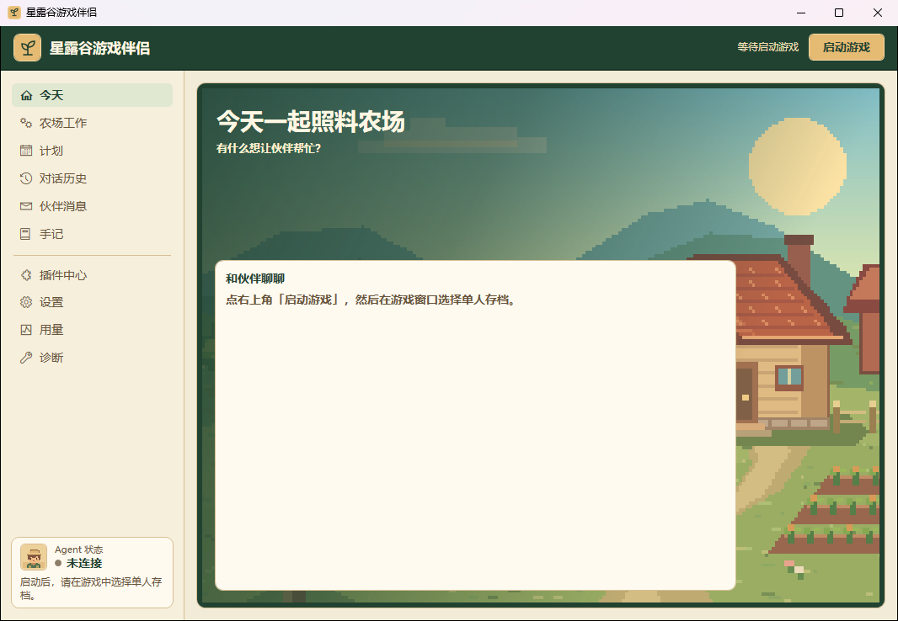

# 星露谷游戏伴侣使用指南

也可阅读[在线文档](https://nekoimi.github.io/stardew-game-companion/)，按安装、模型、页面功能与常见问题逐项查看。本文件继续作为绿色包随附的完整说明。

## 启动

1. 准备 Windows x64、《星露谷物语》及已安装的 SMAPI。从 GitHub Releases 下载 `StardewGameCompanion-*-windows-x64.zip`，可用同名 `.sha256` 文件核对下载。完整解压到可写目录，双击根目录的 **星露谷游戏伴侣.exe**，启动后进入「今天」。[下载绿色包](https://github.com/nekoimi/stardew-game-companion/releases)
2. 在「设置 → 游戏启动」选中包含 StardewModdingAPI.exe 的游戏目录和游玩方式。在「模型连接」配置服务商、模型和 API Key，点击「测试连接」。
3. 点击「启动游戏」，加载单人存档。在「今天」发送自然语言指令。

Node、模型 SDK 和桌面运行库随包提供。启动器加载绿色包的独立 Mod 目录。关闭窗口时可最小化到通知区域，双击图标恢复。退出伴侣会停止 Agent，游戏由玩家保存并退出。

「今天」可查看思考、寻路、执行和复查状态；「最近进展」可刷新游戏观察或核对旧动作，刷新不会重新执行或交还控制权。「农场工作」按目标、请求和日期整理阶段进展，实际数量来自原生效果或背包变化，没有数量依据时保留未知。

桌面状态推送短暂中断时自动重连，保留进展、所选目标与输入草稿；恢复前暂不可提交或控制游戏，仍可编辑草稿。游戏可能继续执行，需要停止时在游戏中按 F9 接管；「伙伴服务已退出」则使用重连入口并核对旧动作。

模型临时限流、断线或超时后最多自动重试三次，恢复后继续当前回合。鉴权、余额错误或重试耗尽时，按桌面提示处理，再重新发送要求或应用模型设置。

寻路和农事移动支持直走和斜走，通畅的路段连续通过。经过门口、狭窄通道和工具交互点时，游戏会先对准站位。

运行时自动保留每个存档最近 2000 条原生回执，启动时及每新增 128 条检查一次；待核对动作、插件引用和进行中目标的证据额外保留，对话和手记不受影响。已释放的 SQLite 空间供后续写入复用，数据库文件不保证立即缩小。

## 插件中心

点击「安装本地插件」选择 ZIP，核对发布者和来源后确认。安装后可手动启用，或启用后打开「随伴侣程序自动启动」开关。最小化到托盘时插件继续运行，退出伴侣时停止由它启动的插件。

带设置页的插件可点击「打开插件设置」，由系统浏览器打开对应的本机页面。插件显示「需重启」时可以从详情页重启。卸载确认框默认勾选「保留插件的数据与设置」。插件自己的日志入口位于详情页，宿主的启停和连接日志可从「诊断」查看。

运行中的插件可以订阅公开的游戏状态、动作结果和伙伴回复，也可以向 Agent 提交独立指令。「今天」会标出指令来自哪个插件。玩家仍可改派、暂停或用 F9 接管。「停止插件」会中止该插件的活动回合。 [插件接口](https://nekoimi.github.io/stardew-game-companion/reference/plugin-protocol)

在「插件中心 → 在线目录」填写目录的 HTTPS 地址并加载，即可选择兼容版本并确认安装或更新。宿主自动校验发布者签名和 ZIP 哈希。可从详情页「回退版本」恢复上一版本及数据。 [在线目录协议](https://nekoimi.github.io/stardew-game-companion/reference/plugin-catalog)

## 模型配置

- **DeepSeek 和 OpenAI 官方**。填官方 API Key，可用默认模型、从列表选模型或手填模型 ID。「高级设置」提供流式开关，有已知支持时显示推理档位。
- **自定义接口**。选择 Chat Completions 或 Responses，填 HTTPS Base URL、网关模型 ID 和网关 Key。Base URL 保留 `/v1` 等前缀，程序会拼接 `/chat/completions` 或 `/responses`。网关只支持完整响应时，关闭「流式输出」。
- 「测试连接」按当前模式核对工具调用与回执。「保存模型设置」供下次启动使用。读档后可在空闲时点击「应用模型」，在当前游戏中继续使用同一角色、手记、对话和工作目标。

桌面设置在 data/desktop-settings.json，伙伴资料和用量按存档存在 data/companion.sqlite。API Key 由当前 Windows 用户的凭据管理器保存，换目录或电脑后重新填写。保存后输入框会保留掩码内容，留空表示继续使用已保存的 Key，填写新值会替换它。模型会收到指令及相关游戏观察、工具结果与手记。

## 和伙伴一起玩

「AI 自己玩（单人）」为首启默认。点「交给 AI」后允许 AI 操作玩家角色，按 **F9** 随时接管。伙伴模式下，AI 操作有独立背包、工具和体力的伙伴。更改游玩方式在游戏重启后生效。

| 桌面位置 | 可以做什么 |
| --- | --- |
| 今天 | 查看对话、最近进展、Agent 状态和待确认选项，Ctrl+Enter 发送。「打断并执行」会等上一项动作结算。普通移动、观察和补水不会逐条刷屏，需要处理的结果会保留提示。 |
| 农场工作 | 按目标查看中文工作摘要；完整过程默认折叠，受阻、部分完成和待核对记录会保留。撤回不再需要的目标。 |
| 对话历史 | 回看当前存档的对话。 |
| 计划与伙伴消息 | 查看计划、处理提醒和待确认事项。 |
| 存档偏好与手记 | 读档后在「设置 → 存档偏好」编辑名字、性格、就寝时间与主动帮忙偏好，在「手记」编辑记忆和约定。 |
| 用量 | 查看全局、当前存档和最近任务的请求次数、重试及 Token。缺失项显示「未记录」。 |

就寝时间按存档保存，两种模式都会预留返程时间。伙伴回床后由玩家决定何时结束当天，AI 自己玩则在托管期间回床并走游戏原生过夜保存流程。跨日会按当天观察继续规划未完成的目标。

在伙伴模式下，地图中的伙伴头顶显示「存档偏好」设置的名字，保存后立即更新。伙伴休息时会隐藏名字。

收获与清障后的行动以原生回执、附近掉落物和背包观察为准。若桌面显示「待核对」，点击「核对旧动作」。同一游戏中须确认旧动作终态再继续。重新读档会建立新的游戏会话。

路线规划超时会返回动作失败。伙伴可根据当前地图重查落点，继续尝试附近可站立的格子。

## 更新与回退

在「设置 → 关于与更新」检查并下载正式版，勾选后只查预览版。使用镜像时，填写 HTTPS 版本目录地址并点击「检查更新」保存，可随时恢复默认。也可将 ZIP 和同名 `.sha256` 放在同一目录，再点击「选择更新 ZIP」。校验通过后，保存并退出游戏，再点击「安装并重启」。

更新器在原目录替换程序，并为设置、伙伴记忆、插件和 Mod 数据建立备份。新版自检失败会恢复旧程序。游戏存档仍由《星露谷物语》保存。

使用旧版首次过渡时，先关闭游戏和旧伴侣，将新版解压到独立目录，再在「关于与更新」使用「从旧绿色包导入」，选择旧包根目录。原目录保留，重新打开新版后可访问导入的数据。同一 Windows 用户下可沿用原来的模型凭据。

「迁移当前数据」可把随包保存的数据复制到单独目录，例如在 `%LOCALAPPDATA%` 下建立 `StardewGameCompanion`。重新解压或换目录后可使用「连接已有数据目录」继续使用同一份数据。已有数据目录按整套使用。

## 排查

- 模型连接失败时，在「设置」运行「测试连接」，按提示核对 Key、模型和端点权限。
- 时钟因模型思考或保护暂停时，桌面会标明原因。画面与输入同时停顿时，从「诊断」打开日志目录，在 `mod-*.log` 里查找对应时段的 `slow_game_tick` 事件。
- 桌面、Agent 运行时和游戏 Mod 的诊断事件默认写到当前数据位置的 `data/logs`，每行一条 JSON。可用 `STARDEW_COMPANION_LOG_DIR` 指定绝对路径。SMAPI 继续管理自己的游戏日志。
- 日志单文件最多 10 MiB，程序启动及写入期间自动清理 14 天前的日志，超过 100 MiB 时优先清理可删除的最旧文件。文件日志记录诊断所需的状态和编号，聊天正文、模型原始请求和 API Key 不写入产品日志。
- DeepSeek 官方与第三方 Responses 已通过真实固定场景和同存档切换验证。验收细节见源码仓库中的改造记录。
