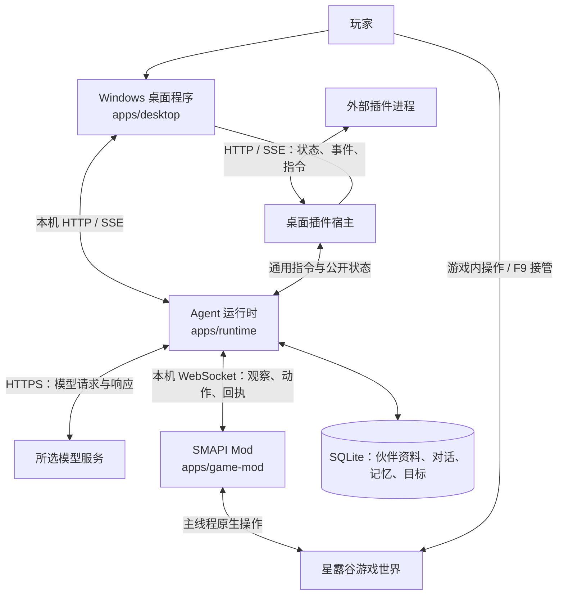
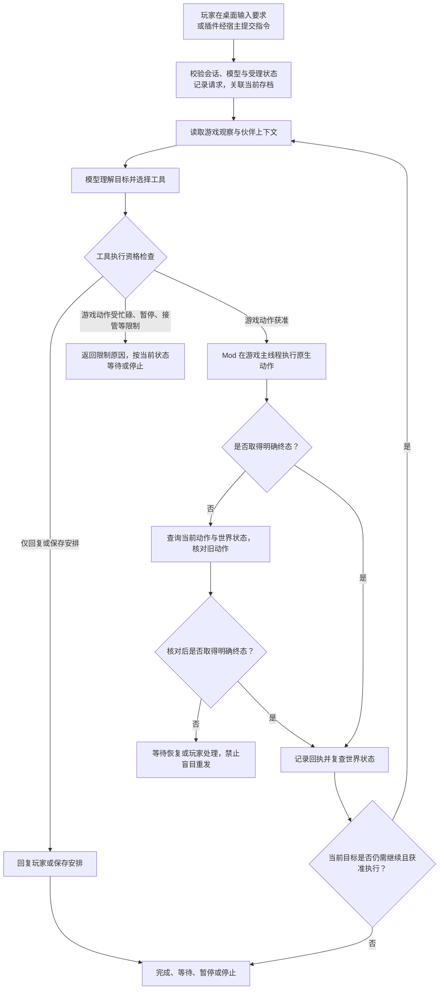

# 架构与目录

项目由 Windows 桌面程序、TypeScript Agent 运行时与 SMAPI Mod 组成。角色、对话、记忆和目标由项目按存档管理，切换模型沿用已有伙伴资料。

## 组件与通信

桌面程序负责启动与配置。运行时负责理解目标、组织回合和保存伙伴数据，Mod 负责读取游戏与执行原生动作。插件通过桌面宿主接入，自己的规则与设置保留在插件进程中。

窄屏下可以横向滚动流程图，查看完整连线。

## 目录职责

| 目录 | 技术与职责 |
| --- | --- |
| `apps/desktop` | C# / WPF：界面、设置、启动、Windows 凭据、运行时与插件进程管理。 |
| `apps/runtime` | TypeScript / Node.js：模型接入、回合执行、SQLite 数据与桌面服务。 |
| `apps/game-mod` | C# / SMAPI：游戏观察、主线程原生动作、状态和结果回执。 |
| `apps/shared` | 共享代码，如文件日志。 |
| `contracts` | 游戏、桌面与插件的协议和共享样例。 |
| `resources/agent` | 实际加载的游戏提示词和指导。 |
| `packaging` | Windows 绿色包构建、编译引用导出和发行包校验。 |
| `tests` | 跨语言契约、插件宿主与隔离验收。 |
| `docs/site` | 本文档站，独立安装构建依赖。 |
| `docs/development` | 完整说明的原文、设计方案、重构 TODO、历史验收记录与界面原型。 |

## 通信边界

桌面通过本机 HTTP / SSE 访问 Agent 运行时，Mod 通过本机 WebSocket 提供游戏观察和动作回执。外部插件连接桌面的插件宿主接口，不直接依赖 Agent 内部实现。

伙伴和 AI 自玩共用回合、观察与动作链路，工具执行时校验忙碌、暂停与控制权。动作超时或回执未知时先查当前动作与世界状态，再安排剩余工作。

## 一条指令如何执行

回执明确后按实际完成量安排剩余工作，动作失败也可能已有部分产出。新要求在工具边界进入后续规划；玩家接管后，AI 不会自动夺回控制权。

## 从哪里开始

- [构建、测试与发布](/reference/contributing)：环境要求、绿色包和手动 Release。
- [游戏通信 v2](/reference/game-protocol)与[桌面 API v2](/reference/desktop-api)：跨进程接口。
- [插件开发](/plugins/)：独立扩展。
- [隔离实机回归](/reference/acceptance)：固定场景的验证边界。

设计草案、重构 TODO、HTML 原型和历史验收记录集中保存在 `docs/development/`，不进入站点构建。公开协议与完整使用说明在构建时按明确清单从原文件引入，避免维护两份正文；站点截图等静态资源位于 `docs/site/public/`。
